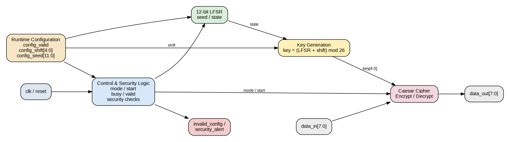

# Design and Verification of a Reconfigurable LFSR Based RTL Architecture for Caesar Cipher Encryption and Decryption

## 1. Project Overview

This project implements a reconfigurable RTL architecture that combines a 12-bit LFSR based key source with Caesar cipher encryption and decryption. The design also includes runtime configuration, a security monitor, UART receiver/transmitter support, functional coverage counters, and verification testbenches.

The implementation flow completed for the project is:

RTL design -> Verilator functional verification -> Yosys synthesis -> Sky130 HD technology mapping -> OpenSTA static timing analysis -> RTL optimization -> repeat synthesis/STA comparison

The project intentionally ends at RTL-to-STA analysis. OpenLane, OpenROAD, placement, routing, and GDSII are outside the chosen scope.

## 2. Main Features

- 12-bit Fibonacci LFSR
- Caesar encryption for upper/lower case alphabetic characters
- Caesar decryption for upper/lower case alphabetic characters
- Non-alphabetic pass-through behavior
- Runtime shift and seed configuration
- Zero-seed protection
- Invalid shift detection
- Configuration-while-busy security alert
- UART 8N1 transmit and receive blocks
- Top-level UART command framing
- Functional coverage counters
- Waveform generation with VCD dumping

## 3. Architecture

The main crypto data path is:

```text
                 +------------------------+
 clk ---------->|                        |
 reset -------->|      Control /         |
 start -------->|  Configuration Logic   |----------------+
 config_valid ->|                        |                |
 config_shift ->|  Security Monitoring   |                v
 config_seed -->|                        |        +---------------+
                 +------------------------+        | 12-bit LFSR  |
                           |                        | Seed / State |
                           |                        +-------+-------+
                           |                                |
                           |                                v
                           |                        +---------------+
                           |                        | Key Generation |
                           |                        | (LFSR + Shift) |
                           |                        |      mod 26    |
                           |                        +-------+--------+
                           |                                |
 data_in[7:0] ------------+--------------------------------v
                                                    +----------------+
 mode -------------------------------------------->| Caesar Cipher  |
                                                    | Encrypt/Decrypt|
                                                    +-------+--------+
                                                            |
                                                            v
                                                    data_out[7:0]

 security_alert <--------- Security Monitor -------- invalid_config
```

A scalable system view is:

```text
UART RX -> Command Frame Parser -> Crypto Core -> UART TX
                               |
                               +-> LFSR -> Key Generation -> Caesar Cipher
```

An SVG and PNG architecture diagram are also provided in `diagrams/`.



## 4. RTL File Organization

| File | Function |
|---|---|
| `baud_tick_gen.sv` | Baud-rate timing tick generator |
| `lfsr_12bit.sv` | Standalone 12-bit Fibonacci LFSR |
| `caesar_encrypt.sv` | Caesar encryption block |
| `caesar_decrypt.sv` | Caesar decryption block |
| `crypto_controller.sv` | IDLE/EXECUTE/DONE controller |
| `crypto_core.sv` | Integrated reconfigurable crypto core |
| `crypto_coverage.sv` | Functional coverage collection module |
| `crypto_reference_pkg.sv` | Reference functions for encryption/decryption/LFSR/key |
| `crypto_assertions.sv` | SVA assertion module |
| `uart_receiver_fsm.sv` | UART receiver FSM |
| `uart_transmitter_fsm.sv` | UART transmitter FSM |
| `top_system_integration.sv` | UART-to-crypto top-level integration |

## 5. Verification Environment

The package contains dedicated testbenches for:

- Caesar encryption
- Caesar decryption
- 12-bit LFSR
- Crypto controller
- Integrated crypto core
- UART receiver
- UART transmitter
- UART/top-level system integration

The main integrated crypto testbench exercises 14 directed tests and 32 randomized tests for a total of 46 crypto transactions. It also tests runtime configuration, invalid shift detection, zero-seed security behavior, and configuration while busy.

## 6. Final Functional Verification Result

Recorded final result:

```text
TOTAL CRYPTO TESTS : 46
PASS                : 46
ERRORS              : 0
CRYPTO VERIFICATION PASS
```

This is the main final functional verification result recorded from the Ubuntu run.

## 7. Functional Coverage Summary

Recorded coverage counters from the completed verification run:

```text
MODE COVERAGE
Encryption transactions : 23
Decryption transactions : 23

SHIFT KEY COVERAGE
Zero    (0)      : 2
Low     (1-8)    : 12
Medium  (9-17)   : 9
High    (18-25)  : 10
Invalid (26-31)  : 13

SEED COVERAGE
Small  (1-255)     : 6
Medium (256-2047)  : 21
Large  (2048-4095) : 19

DATA COVERAGE
Uppercase : 7
Lowercase : 8
Space     : 2
Digit     : 4
Special   : 25
```

All encryption/decryption data categories were exercised at least once. The exact MODE x DATA matrix counts were not preserved in the final terminal summary available for packaging.

## 8. Synthesis and Sky130 Mapping

Recorded tool and library information:

```text
Verilator : 5.044
Yosys     : 0.52
OpenSTA   : 3.1.0
CUDD      : 3.0.0
Technology: Sky130 HD
Liberty   : sky130_fd_sc_hd__tt_025C_1v80.lib
```

Baseline Sky130 mapping:

```text
Cells : 514
Area  : 3758.6048 um^2
```

Optimized Sky130 mapping:

```text
Cells : 380
Area  : 2879.0112 um^2
```

## 9. Static Timing Analysis

Target:

```text
Clock period    : 10 ns
Target frequency: 100 MHz
```

Baseline:

```text
Critical path delay : 11.47 ns
Setup slack         : -1.64 ns
Hold slack          : +0.43 ns
```

Optimized:

```text
Critical path delay : 9.05 ns
Setup slack         : +0.87 ns
Hold slack          : +0.42 ns
```

The optimized implementation therefore meets the 10 ns target in the recorded OpenSTA analysis.

A derived estimate from the recorded timing data gives an approximate zero-slack period of about 9.13 ns, or about 109.5 MHz. This is an inferred estimate, not a directly reported OpenSTA Fmax value.

## 10. Optimization Results

```text
Cell reduction           : 26.1%
Area reduction           : 23.4%
Critical-path reduction : 21.1%
```

The optimization replaced high-level integer arithmetic in the critical key/cipher calculation with fixed-width RTL arithmetic. The exact optimized Ubuntu source file is not reproduced in this package because its raw bytes were not directly accessible during packaging; the reported results are preserved in the reports folder.

## 11. STA Constraint Flow

The final STA run used direct Tcl constraints because `read_sdc crypto_core.sdc` produced a command-abbreviation warning followed by nested evaluation/infinite-loop style failure. The working approach embedded the clock and I/O constraints directly in `sta_run.tcl`.

The reset path was constrained as a false path. The resulting missing reset input-delay warning was expected for this setup.

## 12. Running the Main Simulation

Typical Verilator flow:

```bash
verilator --cc --exe --build --timing \
  rtl/crypto_core.sv \
  verification/tb_crypto_core.sv \
  -o sim_crypto_core
```

Then run the generated executable according to the local Verilator output directory.

For individual blocks, use the corresponding testbench from `verification/`.

## 13. Yosys / Sky130 / OpenSTA Flow

The `scripts/` folder contains the recorded constraint and flow representations used during the Ubuntu work.

High-level flow:

```text
SystemVerilog RTL
      |
      v
    Yosys
      |
      v
Sky130 HD mapped netlist
      |
      v
    OpenSTA
      |
      v
Setup / Hold timing reports
```

## 14. Reports Included

`reports/` contains:

- `verification_final.txt`
- `functional_coverage.txt`
- `synthesis_original.txt`
- `synthesis_optimized.txt`
- `sta_original.txt`
- `sta_optimized.txt`
- `final_results.txt`
- `tool_versions_and_environment.txt`
- `troubleshooting_log.txt`

## 15. Netlist Provenance

The Ubuntu session recorded several generated netlists. Their names and approximate sizes are documented in `netlists/README.md`. The raw VM netlist bytes could not be exported directly into this chat session, so no fabricated netlist content is included.

## 16. Important Source-Version Note

The `rtl/crypto_core.sv` included in this ZIP is the exact integer-arithmetic version most recently pasted into the chat. The final 380-cell / 2879.0112 um^2 / +0.87 ns results were generated from a later optimized RTL revision in Ubuntu. These two source revisions should not be treated as byte-for-byte identical.

## 17. Project Status

Completed technical scope:

```text
RTL Design                 PASS
Functional Verification    PASS
Yosys Synthesis            PASS
Sky130 Mapping             PASS
OpenSTA Setup              PASS
OpenSTA Hold               PASS
RTL Optimization           PASS
```

Remaining work for academic submission is documentation/presentation preparation, not another implementation stage within the chosen RTL-to-STA scope.
